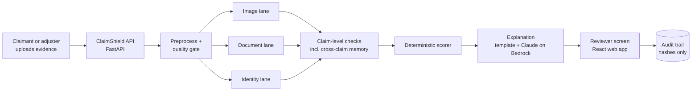
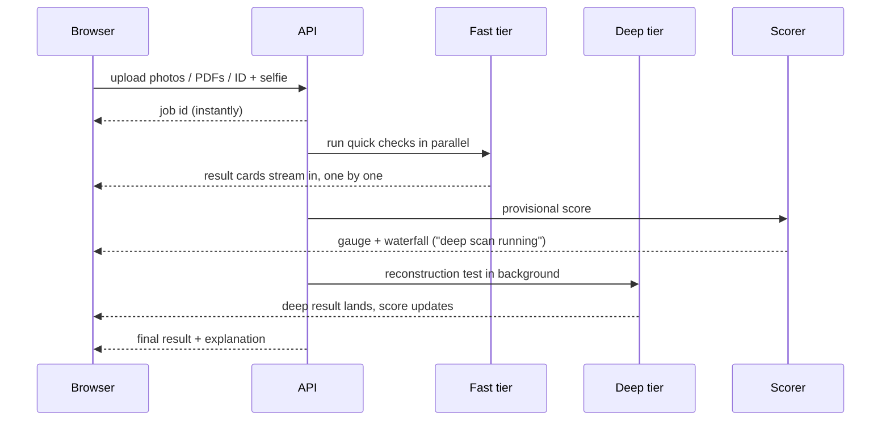
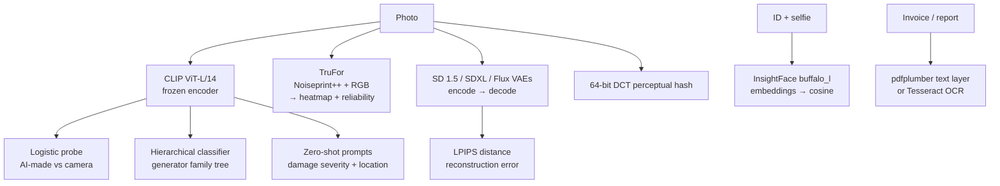
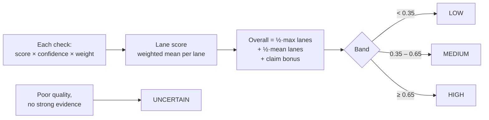
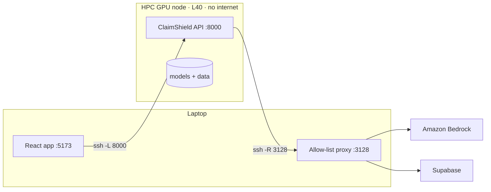

# ClaimShield

**AI-powered synthetic identity & deepfake claim detection** — Adrosonic Build hackathon,
Problem Statement 2.

> Every other team ships a detector. We ship a detector **and the fraudster**.

An insurance claim arrives with evidence — damage photos, invoices or medical reports (PDF or
scanned), an ID card and a selfie. ClaimShield checks every piece with independent forensic
checks, combines them into **one deterministic, explainable risk score**, and shows a human
reviewer *why*. A built-in red-team **Arena** fakes new damage on real photos live and re-scores
them, so "generalises to unseen fraud" is a measured number, not a claim.
**ClaimShield never rejects a claim by itself** — it flags for review.

| | |
|---|---|
| **AUC 0.898** | AI-image probe on a generator family **never seen in training** (Flux, 859 images) |
| **2–6 s** | per complete claim (photo + PDF) on a GPU; result cards stream in before that |
| **200 / 200** | recompressed photo copies linked across claims (fraud-ring memory) |
| **0 / 19,900** | false photo links between genuinely different photos |
| **0 / 200** | honest accident stories flagged by the damage-vs-story check |
| **0 / 200 · 600 / 600** | clean medical bills flagged · inflated bills caught *(synthetic set)* |
| **1,800** | AI-generated images we produced on the HPC (3 generator families × 3 attack types) |

---

## Contents

1. [Repository layout](#1-repository-layout)
2. [High-level design](#2-high-level-design)
3. [The checks (four lanes)](#3-the-checks-four-lanes)
4. [Model architecture](#4-model-architecture)
5. [Scoring](#5-scoring)
6. [Explainable AI and the LLM (Amazon Bedrock)](#6-explainable-ai-and-the-llm-amazon-bedrock)
7. [Privacy, storage and security](#7-privacy-storage-and-security)
8. [Data, training and evaluation](#8-data-training-and-evaluation)
9. [Compute: CPU laptop, GPU, HPC](#9-compute-cpu-laptop-gpu-hpc)
10. [Getting started](#10-getting-started)
11. [Running on the HPC GPU](#11-running-on-the-hpc-gpu)
12. [Demo cases](#12-demo-cases)
13. [API reference](#13-api-reference)
14. [Configuration](#14-configuration)
15. [Make targets, tests, benchmarks](#15-make-targets-tests-benchmarks)
16. [Troubleshooting](#16-troubleshooting)
17. [Honest limits](#17-honest-limits)
18. [References](#18-references)

---

## 1. Repository layout

```
claimshield/
├── claimshield/                  Python backend package
│   ├── api.py                    FastAPI service: uploads, live SSE stream, images, decisions, arena, reports
│   ├── auth.py                   optional Supabase login (token checked with Supabase on every call)
│   ├── pipeline.py               orchestration: fast tier in parallel, deep tier in background
│   ├── preprocess.py             decode / orient / resize / SHA-256 + quality gate
│   ├── contracts.py              the Signal / Card / Result data contracts
│   ├── config.py                 loads configs/*.yaml and environment variables
│   ├── cases.py                  claim folders (data/cases) for the inbox
│   ├── memory.py                 cross-claim memory (hashes only) for fraud-ring links
│   ├── audit.py                  SQLite audit trail (hashes, scores, decisions)
│   ├── regions.py                merges per-signal heatmaps into reviewer-facing regions
│   ├── signals/                  one forensic check per file, all return `Signal`
│   │   ├── forensics/            c2pa, exif, jpeg_qtables, copy_move, noise_residual
│   │   ├── localizer/            base interface + trufor + fallback (config switch)
│   │   ├── documents/            pdf_structure, ocr, fields, doc_type, medical_billing
│   │   ├── identity/             face_match (InsightFace)
│   │   ├── clip_probe.py         CLIP ViT-L/14 + logistic probe (AI-made vs camera)
│   │   ├── family_map.py         hierarchical generator-family classifier
│   │   ├── ae_reconstruction.py  training-free autoencoder reconstruction test (deep tier)
│   │   ├── vae.py                SD 1.5 / SDXL / Flux VAE loader
│   │   ├── cross_claim.py        pHash / VIN / vendor / claimant extraction
│   │   └── damage_story.py       CLIP zero-shot: does the damage fit the story?
│   ├── claim/consistency.py      claim-level checks (invoice-before-photo, camera, name)
│   ├── scoring/composite.py      deterministic weighted score → band + waterfall
│   ├── narrative/                template explanation (primary) + LLM rewrite (optional)
│   ├── llm/                      Amazon Bedrock (Claude) client, Qwen fallback
│   ├── arena/                    red-team attacks (Nova Canvas / local SD inpaint) + runner
│   └── ui/app.py                 Streamlit reviewer UI (in-process fallback to the React app)
├── frontend/                     React 19 + Vite + TypeScript + Tailwind reviewer / client web app
│   └── src/
│       ├── pages/                Hero, ClientPortal, CaseView, Arena, Reports
│       ├── components/           signal cards, tabs (Images/Documents/Identity/Score), charts
│       ├── lib/api.ts            typed client for the backend API (+ demo mode)
│       └── context/              auth context (Supabase via the backend)
├── configs/
│   ├── weights.yaml              composite weights (the whole scoring policy)
│   ├── thresholds.yaml           bands, quality gate, per-signal thresholds, localizer switch
│   └── runtime.yaml              device, workers, model ids, arena settings
├── scripts/
│   ├── setup/                    setup_windows.ps1, download_models.py
│   ├── gen/                      dataset + demo-case generators (invoices, medical, tampering, rings…)
│   ├── hpc/                      PBS jobs, HPC helper, Bedrock/Supabase allow-list proxy
│   ├── eval.py, eval_*.py        evaluation harnesses → reports/
│   ├── bench.py                  latency benchmark → reports/latency_latest.md
│   ├── train_heads.py            trains the CLIP probe + family map heads
│   └── smoke_bedrock.py          checks Bedrock key + models
├── tests/                        pytest suite (one test file per signal / module)
├── Makefile                      setup, models, test, eval, bench, heads, arena, demo, api
├── requirements.txt              Python deps (CPU torch wheels by default)
└── .env.example                  every environment variable, empty
```

Not in git (created locally): `models/` (weights), `data/` (datasets, demo cases),
`reports/` (generated metrics), `.env` (secrets).

---

## 2. High-level design



| Block | Job | Code |
|---|---|---|
| **API** | receives uploads, streams results live (SSE), serves heatmaps, login | `claimshield/api.py`, `auth.py` |
| **Pipeline** | runs every check — fast ones first, the slow one in the background | `claimshield/pipeline.py` |
| **Signals** | one small module per check, all with the same result format | `claimshield/signals/`, `claim/` |
| **Scorer** | turns all results into one score, a band and a waterfall | `claimshield/scoring/composite.py` |
| **Explanation** | plain-English summary; an LLM may polish wording, never numbers | `claimshield/narrative/`, `llm/` |
| **Frontend** | reviewer workspace, client portal, Arena, reports | `frontend/` |

### How one claim flows



1. **Upload** — files go to a temp folder that is **deleted as soon as scoring ends**.
2. **Preprocess** — each photo is decoded once (JPEG/PNG/HEIC/WebP), EXIF-oriented, capped at
   1024 px and fingerprinted with SHA-256 (results are cached by that hash).
3. **Quality gate** — too small / too compressed / too blurry → **UNCERTAIN** ("send a clearer
   photo") unless strong deterministic evidence exists (C2PA manifest, PDF version diff, a
   cross-claim link).
4. **Fast tier** — forensics → CLIP probe → localizer run in a thread pool; each card is pushed
   to the browser the moment it is ready. Spec on CPU: first card p95 ≤ 2 s, composite p95 ≤ 8 s.
5. **Deep tier** — the autoencoder reconstruction test runs asynchronously and never blocks the UI.
6. **Score + explanation**, then the reviewer decides (accept / reject / escalate) → audit trail.

### Every check returns a `Signal`

```python
Signal(name, score, confidence, reason, evidence, abstained, applicable)
#  score       0 = looks authentic … 1 = looks manipulated
#  confidence  how much this check trusts itself on this input
#  reason      one adjuster-readable sentence
#  evidence    heatmap / regions / fields / diffs behind the score
#  applicable  False = the check does not apply (e.g. JPEG tables on a PNG)
#  abstained   True  = it applies but could not decide
```

No bare floats anywhere: this uniform record is what makes every score explainable.

---

## 3. The checks (four lanes)

### Image lane — "is this photo real and unedited?"

| Check | What it looks at | Tier |
|---|---|---|
| **C2PA Content Credentials** | cryptographic "made by / edited with" manifest | fast |
| **EXIF** | camera make/model, capture time, editing-software tags | fast |
| **JPEG quantisation tables** | double compression (edited, then re-saved) | fast |
| **Copy-move** | a region cloned inside the same photo | fast |
| **Noise residual** | blocks whose sensor noise doesn't match the rest | fast |
| **CLIP probe** | camera-made vs AI-generated | fast |
| **Generator family map** | which family (SD 1.5, SDXL, Flux, …) it resembles — explanation only | fast |
| **Edit localizer (TruFor / fallback)** | heatmap of *where* the photo was edited + reliability map | fast |
| **AE reconstruction** | AI pixels survive a VAE round trip better than camera pixels | deep |

### Document lane — "was this invoice or report altered?"

| Check | What it looks at |
|---|---|
| **PDF "time machine"** | incremental updates keep old versions; we recover them and diff what changed |
| **Producer mismatch** | creator vs producer software, creation vs modification dates |
| **Font anomaly** | a rogue font used on a few digits (classic edited total) |
| **OCR** | PDF text layer, or Tesseract for scans / photos of paper; low-confidence digit dips |
| **Arithmetic** | line items, subtotal, GST and total actually add up |
| **Dates / formats** | impossible dates; invoice numbers, ICD-10 codes, passport MRZ check digits |
| **Medical billing** | procedure the diagnosis doesn't need, stay too long, more days billed than stayed |

Scanned documents also get the image checks that make sense on paper.

### Identity lane — "is this the same, real person?"

| Check | What it looks at |
|---|---|
| **Face match** | InsightFace embedding cosine between ID photo and selfie |
| **Selfie synthetic** | the selfie itself through the image checks |

### Claim level — "does the whole story hold together?"

| Check | What it looks at |
|---|---|
| **Invoice before photo** | repair invoice dated before the damage photo was taken |
| **Camera mismatch** | photos of "one accident" from different cameras |
| **Name mismatch** | ID name ≠ invoice / report name |
| **Cross-claim memory** | same photo (even resized / recompressed), VIN, shop, claimant or hospital stay seen in another claim |
| **Damage vs story** | visible damage (CLIP zero-shot severity + location) contradicts the claimant's description |

---

## 4. Model architecture

Different *kinds* of evidence are combined on purpose, so fooling one detector is not enough.



| Model | Role | Why | Trained by us? |
|---|---|---|---|
| **CLIP ViT-L/14** (OpenAI weights, `open_clip`) | frozen features | separate real from AI images and generalise to unseen generators (Ojha et al., CVPR 2023) | only a small logistic probe |
| **Family map** | hierarchical heads on CLIP features | tells the reviewer *which kind* of generator | yes (small heads) |
| **TruFor** | forgery localizer | localises edits with a reliability map (Guillaro et al., CVPR 2023) | no |
| **Fallback localizer** | mini-AE + noise residual | same interface, permissive, switch in config | no |
| **SD 1.5 / SDXL / Flux VAEs + LPIPS** | reconstruction test | training-free (AEROBLADE, Ricker et al., CVPR 2024); 1 VAE on CPU, 3 on GPU; confidence capped at 0.7 | no |
| **InsightFace buffalo_l** | face embeddings | fast, standard ID ↔ selfie match | no |
| **Tesseract** | OCR | scans and photos of documents | no |
| **Claude on Amazon Bedrock** | narrative rewrite | plain English — **text only, never numbers** | no |
| **Amazon Nova Canvas** (Bedrock) | Arena attacker | inpaints fake damage on a real photo live | no |
| **SD 1.5 inpainting** (local) | Arena fallback | when Bedrock is unavailable | no |

---

## 5. Scoring



- **Deterministic.** `claimshield/scoring/composite.py`, weights in `configs/weights.yaml`,
  bands in `configs/thresholds.yaml`. No conditional gates. Same evidence → same score.
- Each check's influence is bounded by its weight **and** its own confidence; experimental
  checks (AE reconstruction, damage-vs-story) have hard confidence caps.
- The **waterfall** shows exactly how much each check moved the score.
- **An LLM never produces or adjusts a number.**

---

## 6. Explainable AI and the LLM (Amazon Bedrock)

1. A **template** turns the waterfall and each signal's reason into a short explanation —
   instantly, every time. This is the primary narrative.
2. Names, ID numbers and similar PII are replaced by placeholders (`[NAME_1]`) **before** any
   text leaves the server.
3. **Claude on Amazon Bedrock** (`converse` API, temperature 0) may rewrite that text. The rewrite
   is used only if it arrives within **4 s** and keeps **every number and placeholder unchanged**;
   otherwise the template stays. Qwen (OpenAI-compatible) is the configured fallback LLM.
4. Placeholders are filled back in locally for the reviewer.

Reviewer visuals: gauge, per-check cards with one-sentence reasons, edit heatmaps and regions,
PDF version diff, generator-family sunburst, score waterfall, linked-claims panel.

**Bedrock setup.** Auth is a bearer token (`AWS_BEARER_TOKEN_BEDROCK`) picked up by `boto3`;
region `us-east-1`. Enable model access for your Claude text model and
`amazon.nova-canvas-v1:0` in the Bedrock console, then:

```bash
python scripts/smoke_bedrock.py      # text, narrative, optional Nova inpaint — PASS/FAIL each
```

Without Bedrock everything still works: template narrative, and the Arena falls back to local SD
inpainting, then to pre-generated attacks.

---

## 7. Privacy, storage and security

| What | Where | What is kept |
|---|---|---|
| Uploaded files | temp folder | **deleted right after scoring** |
| Audit trail | SQLite | SHA-256 of files, scores, band, reviewer, decision, time |
| Cross-claim memory | same SQLite | photo pHash and **SHA-256 of** VIN / shop / name / stay — never the values |
| Accounts | Supabase Auth + `user_profiles` (role) | email, name, role; row-level security |
| LLM traffic | Bedrock | placeholder text only — no PII, no images |

Login is optional: the backend validates every token **with Supabase itself** (so revoked
sessions stop working immediately) and reads the role from `public.user_profiles` with the user's
own token — no service key on the server. Without `SUPABASE_*` the app offers demo personas.

Compliance by design: flag for review, never auto-deny; reproducible scores; an explicit
UNCERTAIN result instead of a guess.

---

## 8. Data, training and evaluation

**Generated on the HPC GPU (NVIDIA L40):** 1,800 AI images — SD 1.5, SDXL, Flux.1-schnell ×
text-to-image, image-to-image, inpainting of real damage seeds with damage masks — plus JPEG
q90/70/50 and downscale variants.

**Real data:** 1,050 seed photos (vehicle damage, forms), 200 real face crops, 1,649 real
"wild" photos used **only** to measure false alarms.

**Splits** are made by source photo, so an image and its edits never sit on both sides.
**Flux is held out completely** — never used for training or calibration — so the held-out
AUC is a real generalisation number.

```bash
python scripts/gen/make_prompts.py && python scripts/gen/masks.py   # prompts + damage masks
bash scripts/hpc/hpc.sh push && bash scripts/hpc/hpc.sh submit       # generate fakes on the HPC
bash scripts/hpc/hpc.sh pull                                         # → data/generated/
python scripts/gen/recompress.py && python scripts/gen/manifest.py   # variants + manifest/splits
python scripts/gen/invoices.py && python scripts/gen/tamper_pdf.py   # document set
make heads                                                           # CLIP probe + family map
make eval                                                            # → reports/eval_latest.md
```

Eval metrics: AUC, AP, TPR @ 1 % / 5 % FPR per signal and composite (seen vs held-out Flux),
real-wild FPR at HIGH with 95 % CI, document-level P/R, Arena attack × signal table.
Extra harnesses: `scripts/eval_medical.py`, `scripts/eval_damage_story.py`.

---

## 9. Compute: CPU laptop, GPU, HPC

The same code runs everywhere; `CLAIMSHIELD_DEVICE=cpu|cuda` picks the device.

| Component | CPU laptop | GPU |
|---|---|---|
| CLIP ViT-L/14 + probe | 1–2 s | 50–100 ms |
| TruFor | 2–4 s | 0.2 s |
| AE reconstruction (deep tier) | 5–8 s (1 VAE, 384 px) | 0.3 s (3 VAEs, 512 px) |
| Forensics (C2PA/EXIF/JPEG/copy-move/noise) | 0.5–2 s | — |
| OCR per page | 1–3 s | — |
| InsightFace | 100–300 ms | 20 ms |
| Nova Canvas inpaint (API) | 3–8 s | — |
| Narrative LLM (API) | 1–4 s, 4 s swap cut-off | — |

**HPC (BIT Mesra, PBS scheduler, NVIDIA L40, Python 3.10).** Used for dataset generation and
as the GPU demo backend. Compute nodes have **no internet**: weights are downloaded on the login
node; at demo time Bedrock and Supabase traffic is tunnelled back through a tiny allow-list proxy
on the laptop (`*.amazonaws.com`, `*.supabase.co` only; TLS end to end, the proxy never sees
tokens or text).



**Scaling path:** every lane is an independent worker behind the same `Signal` contract; the
prototype runs as one service, production runs lanes as separate workers behind a queue. Models
load once, results are cached by SHA-256, scoring costs microseconds, and only risky claims reach
humans — adjuster effort scales with risk, not volume.

---

## 10. Getting started

### Prerequisites

| | Needed for |
|---|---|
| Python 3.11 | backend |
| Node.js 18+ | frontend |
| Tesseract + Poppler on `PATH` | OCR and PDF page rendering |
| MSVC C++ Build Tools (Windows) | building `insightface` |
| ~10 GB disk | model weights |

### Backend

```powershell
git clone <repo-url> claimshield
cd claimshield
copy .env.example .env                       # fill in what you have (all optional)

# Windows one-shot: tools, venv, pip install, tests
powershell -ExecutionPolicy Bypass -File scripts\setup\setup_windows.ps1
.venv\Scripts\activate

python scripts\setup\download_models.py      # CLIP, VAEs, LPIPS, TruFor, InsightFace; OK/FAIL per item
                                             # add --gpu for SDXL + Flux VAEs
uvicorn claimshield.api:app --port 8000      # or: make api
```

Linux / macOS: `python3.11 -m venv .venv && source .venv/bin/activate && pip install -r requirements.txt`,
then the same `download_models.py` and `uvicorn` lines. For CUDA, install the matching torch
wheel and set `CLAIMSHIELD_DEVICE=cuda`.

Check: http://localhost:8000/api/health → `{"ok": true, ...}`; http://localhost:8000/docs lists
every endpoint.

The CLIP probe and family map heads (`models/heads/*.pkl`) come from `make heads` after the
dataset exists; until then those two cards show as not ready and the rest of the system runs.

### Frontend

```powershell
cd frontend
npm install
npm run dev                                  # http://localhost:5173
```

Top-right switch: **Live API** (real backend, default) or **Demo** (built-in sample data, no
backend needed). The backend URL defaults to `http://localhost:8000`; override it with
`VITE_API_URL` in `frontend/.env` (template: `frontend/.env.example`).
Production build: `npm run build` → `frontend/dist/`.

### Streamlit fallback UI

```bash
make demo                                    # streamlit run claimshield/ui/app.py, models pre-warmed
```

### Environment variables (`.env`)

| Variable | Purpose | Without it |
|---|---|---|
| `AWS_BEARER_TOKEN_BEDROCK`, `AWS_REGION` | Bedrock auth | template narrative; Arena uses local fallback |
| `BEDROCK_TEXT_MODEL_ID` | Claude model id enabled in your account | template narrative |
| `BEDROCK_IMAGE_MODEL_ID` | `amazon.nova-canvas-v1:0` | Arena uses local SD inpaint |
| `CLAIMSHIELD_LLM_PRIMARY` | `bedrock` \| `qwen` \| `template` | `bedrock` |
| `QWEN_API_KEY`, `QWEN_BASE_URL`, `QWEN_MODEL` | fallback LLM (OpenAI-compatible) | — |
| `CLAIMSHIELD_DEVICE` | `cpu` \| `cuda` | `cpu` |
| `CLAIMSHIELD_MODELS_DIR` | where weights live | `./models` |
| `SUPABASE_URL`, `SUPABASE_ANON_KEY` | real email/password login | demo personas |

Never commit `.env` (it is git-ignored).

---

## 11. Running on the HPC GPU

One-time: SSH key login to the cluster (`ssh-copy-id <user>@<hpc-login>`), then from Git Bash on
the laptop:

```bash
export HPC=<user>@<hpc-login>
bash scripts/hpc/hpc.sh check     # ssh, hello-world GPU job, scp round trip
bash scripts/hpc/hpc.sh push      # scripts + seeds + masks + prompts → $SCRATCH/claimshield
bash scripts/hpc/hpc.sh setup     # venv + weights on the login node (scripts/hpc/setup_hpc.sh)
bash scripts/hpc/hpc.sh submit    # qsub scripts/hpc/generate.pbs (resumable; resubmit on walltime)
bash scripts/hpc/hpc.sh status    # qstat + last log lines
bash scripts/hpc/hpc.sh pull      # generated images → data/generated/
```

**GPU demo backend** (from the repo on the HPC, with its own `.env`):

```bash
qsub -l walltime=08:00:00 scripts/hpc/demo.pbs   # API :8000 + Streamlit :8501 on a GPU node
cat logs/demo_node.txt                           # which node, GPU, whether the Bedrock tunnel is up
```

On the laptop:

```powershell
python scripts/hpc/bedrock_proxy.py              # allow-list proxy on 127.0.0.1:3128
ssh -N -J <user>@<hpc-login> -R 3128:127.0.0.1:3128 -L 8000:127.0.0.1:8000 -L 8501:127.0.0.1:8501 <user>@<gpu-node>
cd frontend && npm run dev                       # the web app now talks to the GPU backend
```

---

## 12. Demo cases

Each script writes claim folders into `data/cases/` (they appear in the inbox) and resets the
cross-claim memory. Open each group in order.

```bash
python scripts/gen/ring_cases.py     # fraud ring: r1 → r2 (same photo) → r3 (same VIN + shop)
python scripts/gen/health_cases.py   # health: h1 → h2 (same stay twice) → h3 (upcoded) → h4 (legit follow-up)
python scripts/gen/story_cases.py    # damage vs story: s1 (mismatch) → s2 (legit)   [needs CLIP]
```

Or file a claim from the web app: **+ New Claim** → photos / PDF / ID + selfie → "What
happened?" → submit. Reviewer flow: **Reviewer Login** → **Receiver Portal** → open a claim →
Images / Documents / Identity / Score → Accept / Reject / Escalate (saved to the audit trail).

**Arena:** pick a seed photo → Nova Canvas paints a dent on it → the same pipeline re-scores the
fake side by side with the original. `make arena` runs the offline attack × signal table into
`reports/arena.csv`.

---

## 13. API reference

| Method | Endpoint | Purpose |
|---|---|---|
| GET | `/api/health`, `/api/config` | model readiness, runtime config |
| GET | `/api/cases` | inbox |
| POST | `/api/cases` | new claim (photos, documents, ID, selfie, description) → job id |
| POST | `/api/cases/{id}/score` | re-score an existing case |
| GET | `/api/jobs/{job}/events` | live result cards (Server-Sent Events) |
| GET | `/api/cases/{id}` | full result: score, band, signals, waterfall, narrative |
| GET | `/api/cases/{id}/images/{i}/{kind}.png` | heatmaps / overlays |
| GET | `/api/cases/{id}/documents/{i}/page.png` | rendered PDF page |
| GET | `/api/cases/{id}/identity/{role}.png` | ID / selfie crops |
| POST | `/api/cases/{id}/decision` | accept / reject / escalate → audit trail |
| GET | `/api/cases/{id}/history` | audit history |
| GET | `/api/arena/seeds`, `/api/arena/seeds/{name}` | Arena seed photos |
| POST | `/api/arena`, `/api/arena/{aid}/attack` | start Arena run / attack |
| GET | `/api/arena/{aid}`, `/api/arena/{aid}/{which}/{kind}.png` | Arena result + images |
| GET | `/api/reports/{heldout,eval,medical_billing,damage_story,latency}` | measured reports |
| GET/POST | `/api/auth/{status,signup,login,logout,user}` | Supabase login |

Interactive docs: `http://localhost:8000/docs`.

---

## 14. Configuration

| File | Controls |
|---|---|
| `configs/weights.yaml` | per-signal weights per lane, overall formula — **the scoring policy** |
| `configs/thresholds.yaml` | bands (0.35 / 0.65), quality gate, abstain rules, localizer `impl: trufor \| fallback`, document tolerances, face-match cut-off, narrative timeout |
| `configs/runtime.yaml` | device, fast-tier workers, CLIP / VAE / TruFor locations, Arena prompts and timeouts |

Any scorer change → `make eval`; any latency-affecting change → `make bench`.

---

## 15. Make targets, tests, benchmarks

| Command | Does |
|---|---|
| `make setup` | `pip install -r requirements.txt` |
| `make models` | download all weights |
| `make test` | `pytest -q` |
| `make heads` | train CLIP probe + family map |
| `make eval` / `make calibrate` | eval report → `reports/eval_latest.md` |
| `make bench` | latency p95 (first card / composite / deep) → `reports/latency_latest.md` |
| `make arena` | offline attack × signal table → `reports/arena.csv` |
| `make smoke` | Bedrock smoke test |
| `make api` | FastAPI on :8000 |
| `make demo` | Streamlit reviewer UI |

---

## 16. Troubleshooting

| Symptom | Fix |
|---|---|
| Red banner "Can't reach the ClaimShield server" | backend not running / tunnel closed → start it, or switch the app to **Demo** |
| Login says "not configured" | set `SUPABASE_URL` / `SUPABASE_ANON_KEY` in the backend `.env` |
| Explanation always "Written from a template" | Bedrock key/model missing or slow — the template is the designed fallback |
| Health lists "Model not ready" | `python scripts/setup/download_models.py` on the backend machine |
| PDF page picture missing / OCR skipped | install Poppler + Tesseract and add them to `PATH` |
| TruFor fails to load | set `localizer: {impl: fallback}` in `configs/thresholds.yaml` |
| `insightface` fails to install on Windows | install MSVC C++ Build Tools (the setup script does) |

---

## 17. Honest limits

- Scores are not calibrated probabilities yet; we present **bands**.
- Medical-billing numbers are on a synthetic set (generator and check share the care table).
- C2PA library does not load on the HPC's OS (works elsewhere).
- No adversarial-perturbation testing or face-match demographic audit yet.
- TruFor weights are under a research licence (prototype use only); the fallback localizer is
  the permissive path.

---

## 18. References

- Ojha, Li, Lee. *Towards Universal Fake Image Detectors that Generalize Across Generative
  Models.* CVPR 2023 — CLIP feature probe.
- Guillaro et al. *TruFor: Leveraging All-Round Clues for Trustworthy Image Forgery Detection
  and Localization.* CVPR 2023 — localizer.
- Ricker, Lukovnikov, Fischer. *AEROBLADE: Training-Free Detection of Latent Diffusion Images
  Using Autoencoder Reconstruction Error.* CVPR 2024 — AE reconstruction test.
- Radford et al. *Learning Transferable Visual Models From Natural Language Supervision.* ICML
  2021 — CLIP.
- Zhang et al. *The Unreasonable Effectiveness of Deep Features as a Perceptual Metric.* CVPR
  2018 — LPIPS.
- Deng et al. *ArcFace.* CVPR 2019 — InsightFace embeddings.
- C2PA Technical Specification — Content Credentials.
